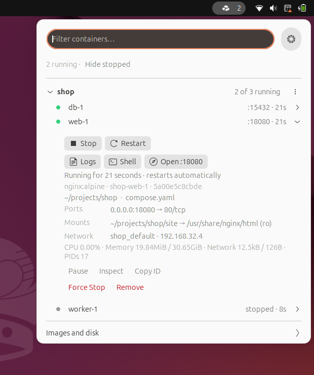
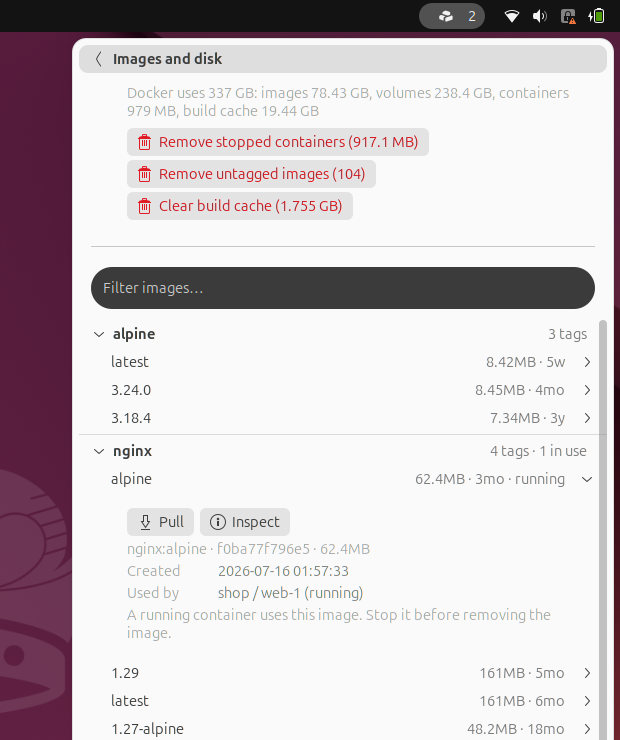

<picture>
  <source media="(prefers-color-scheme: dark)" srcset="docs/branding/wordmark-white.svg">
  
</picture>

**Docker containers in the GNOME top bar, grouped by Compose project.**

[](https://github.com/ronitjadhav/berth/actions/workflows/ci.yml)

[](LICENSE)

<p>
  
  
</p>

Berth shows what is running at a glance and where each container came from. Start, stop, read logs or open a shell without typing a `docker` command. It updates the moment Docker reports a change, and on a local Docker it runs no background process.

## Highlights

- **Grouped by Compose project**, with each container's folder and Compose files one click away.
- **Live**: the panel count and the list follow Docker's own events. Nothing polls.
- **Daily tools first**: logs, a shell inside the container, and its published port in the browser.
- **Whole projects**: start, stop, restart or remove a Compose project from its section.
- **Images and disk**: see which containers use an image before removing it, and free disk space in a click.
- **Careful by default**: destructive actions ask twice, secrets never appear on screen, and crash alerts don't cry wolf.
- **Light**: nothing is built while the menu is closed. Tested on GNOME Shell 46, 50 and 51.

## Install

You need GNOME Shell 46 to 51 (Ubuntu 24.04 LTS, 26.04 LTS and 26.10, Fedora 40 and later), the `docker` CLI with the Compose plugin, and access to the Docker daemon (usually membership in the `docker` group).

```sh
git clone https://github.com/ronitjadhav/berth.git
cd berth
make install-copy
```

Then restart GNOME Shell and turn Berth on. On X11, press <kbd>Alt</kbd>+<kbd>F2</kbd>, type `r` and press <kbd>Enter</kbd>. On Wayland, log out and back in.

```sh
gnome-extensions enable berth@ronitjadhav
```

**Update**: run `git pull` and `make install-copy` in the checkout, then restart GNOME Shell.
**Remove**: run `make uninstall`, then restart GNOME Shell.

To work on Berth instead, use `make install`. It links the checkout itself into the extensions folder, so a shell restart picks up every change. See [Development](#development).

## Using Berth

### The panel

The icon shows how many containers are running. It turns red while a container fails its health check or keeps restarting.

### The container list

Each Compose project is a section with a count such as "2 of 3 running". Click its name to fold or unfold it. Containers started with plain `docker run` are listed under *Standalone*. Two projects with the same name in different folders stay apart, with the parent folder in brackets.

A dot shows each container's state: green running, yellow paused, red unhealthy or restarting, grey stopped. Stopped containers stay out of the way until you click *Show N stopped* in the summary line.

Type to filter by container, image, service or project name. <kbd>Enter</kbd> jumps to the first match, and opens it when it is the only one.

### A container

Click a container to expand it.

1. **Buttons**: Stop (or Start, or Resume) and Restart, then Logs, Shell and *Open :port* for its first published port. Logs and Shell open in your terminal.
2. **Its state in a sentence**: "Running for 2 hours · healthy · restarts automatically", "Failed 3 weeks ago · exit code 1" or "Killed: out of memory". A failed container also shows its last lines of output, which usually say why.
3. **Where it comes from**: the image, its full name and ID, then the Compose folder and files. The folder opens in your file manager, a file in your editor.
4. **Ports, mounts and networks**, then live CPU, memory and network use.
5. **The rare actions**, quietly at the end: Pause, Inspect and Copy ID, then Force Stop and Remove on their own line.

### A project

The ⋯ button on a project shows its folder and every Compose and env file its actions read. Then come Start (`docker compose up -d`), Stop and Restart; Logs, a terminal in the folder and the folder itself; and *Remove containers* (`docker compose down`).

If the folder is gone, or the project's Compose labels can't be trusted, Berth says why and offers no actions.

### Images and disk

The row at the bottom of the menu leads to a second page. It starts with how much disk Docker uses and three buttons to free some: remove stopped containers, remove untagged images, clear the build cache. Each button shows what it frees.

Below are your images, grouped by repository, with untagged build leftovers folded at the end. Expand an image for its ID, size, date, other tags and the containers that use it, with Pull, Inspect and Remove.

- A running container still uses it: Remove is blocked, so nothing breaks.
- Only stopped containers use it: Remove warns that they can't start again until the image is back.
- The image has other tags: Remove only drops this tag.

### Notifications

Berth tells you when a background container exits with an error, with a button to open its logs. It stays quiet when you stop a container yourself, from Berth or the command line. It also stays quiet for Ctrl+C, `docker compose run` and containers attached to a terminal. A crash loop is reported once, not on every restart.

### Safety catch

Remove, Force Stop, *Remove containers* and the disk buttons need a second click within four seconds. The button turns red and says what the next click will do.

### Keyboard

Arrow keys move through the list. <kbd>Right</kbd> and <kbd>Left</kbd> open and close a section or a container. <kbd>Tab</kbd> reaches the buttons. <kbd>Enter</kbd> on *Images and disk* switches page, and on the back row returns.

## Preferences

Open them with the ⚙ button in the menu, or with `gnome-extensions prefs berth@ronitjadhav`.

| Setting | Default | |
| :-- | :-- | :-- |
| Label | Running containers | or *Running / all*, or *Icon only* |
| Position | Right | left, center or right part of the top bar |
| Show stopped containers | off | also the *Show N stopped* / *Hide stopped* link in the menu |
| Group by Compose project | on | |
| Hide one-off containers | on | containers made by `docker compose run`; one you named with `--name` stays visible |
| Live CPU and memory usage | on | measured every 3 s for expanded containers on screen while the menu is open |
| Notify when a container crashes | on | |
| Docker command | `docker` | a full path, or a command with arguments such as `flatpak-spawn --host docker` |
| Terminal command | automatic | for example `alacritty -e`; when empty, Berth tries `xdg-terminal-exec`, Ptyxis, Console, GNOME Terminal, Konsole and others |
| Shell inside containers | `bash` | falls back to `sh` |

## Troubleshooting

- **"No permission to use Docker"**: add yourself to the `docker` group, then log out and back in.

  ```sh
  sudo usermod -aG docker $USER
  ```

- **"Docker is not running"**: click *Start Docker* in the menu. Berth asks systemd to start it, and polkit asks for your password.
- **Berth shows other containers than your terminal does**: GNOME Shell doesn't read your shell's startup files, so a `DOCKER_HOST` exported there is invisible to it. Use a Docker context instead, which Berth reads the way the CLI does.

  ```sh
  docker context use <name>
  ```

- **"Docker CLI not found"** although `docker` works in a terminal: set its full path under *Docker command* in the preferences.
- **Logs or Shell open nothing**: set *Terminal command* in the preferences, for example `alacritty -e` or `wezterm start --`.
- **Anything else**: this shows what went wrong. Please include it in a bug report.

  ```sh
  journalctl -f -o cat /usr/bin/gnome-shell
  ```

## Security and privacy

- **Local only.** Berth talks to your Docker daemon and nothing else. It makes no network requests of its own and collects no telemetry.
- **No privilege escalation.** Berth never uses `sudo` or `pkexec`. *Start Docker* asks systemd, which asks polkit for your password.
- **Docker access is root access.** Anyone who can use the Docker daemon can control the machine. Berth only uses the access you already have.
- **Secrets stay off screen.** Environment variables often hold passwords, so the menu never shows them. *Inspect* prints them in your terminal, so mind screen sharing.
- **No shell injection.** Docker is called with argument lists, never through a shell. In terminal commands, every container ID, path and name is quoted.
- **Compose labels are checked.** Project actions use the files recorded in the containers' labels, and the project panel lists them all before you act. An image could set those labels itself to point at files of its choosing. Berth checks the images and turns project actions off when one does, or when a project's containers disagree about their files. An image can't hide its containers either: a container counts as a `compose run` one-off only when Compose's own name for it says so.
- **Nothing lingers.** Docker queries time out, and every query stops when the extension is turned off. Changes you asked for (start, stop, Compose, remove, clean-up) always run to the end, even when the screen locks.
- **Clipboard** is written only when you press *Copy ID*.

Report a vulnerability privately as described in [SECURITY.md](SECURITY.md), not in a public issue.

## How Berth talks to Docker

When Docker listens on a local socket, Berth reads the container list and the event stream straight from it, as the `docker` CLI does. That covers the default setup, rootless Docker, Docker Desktop and Colima. It finds the socket the way the CLI does: `DOCKER_HOST`, then `DOCKER_CONTEXT`, then the current context in your Docker config. No process runs in the background.

Everything else goes through the `docker` CLI: Compose, logs, shells, images, disk usage and every action.

With a remote context (`ssh://`, `tcp://`) or a custom *Docker command*, Berth uses the CLI for everything. One `docker events` process then runs while the extension is on.

## Development

```sh
make install   # link the checkout into the extensions folder; restart the shell to load changes
make test      # unit tests for the Docker parsing, no GNOME Shell needed
make lint      # ESLint
make pack      # build berth@ronitjadhav.shell-extension.zip
```

Follow the shell's log while you test:

```sh
journalctl -f -o cat /usr/bin/gnome-shell
```

Three files hold the code. `docker.js` makes every Docker call and has no GNOME Shell imports, so the tests run it under plain `gjs`. `indicator.js` is the menu. `prefs.js` is the preferences window.

CI runs the tests, ESLint and a strict check of the settings schema on every push and pull request.

## Logo and artwork

Three orange blocks form one compact stack: containers, grouped. The top bar uses a monochrome version that follows your GNOME theme, and turns red with Berth's warning. All [logos, avatars and the social card](docs/branding/README.md) are in `docs/branding`.

## License

GPL-2.0-or-later. See [LICENSE](LICENSE).
